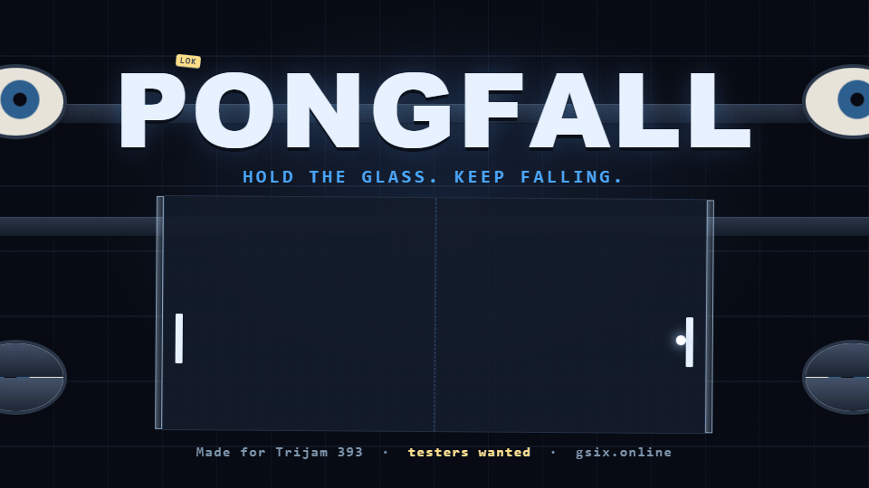

# PongFall

Pong in an arena that never stops falling down a deep shaft. Glass sides that crack and break, eyes in the walls, tears to slice, a Power Paddle, and something watching from the dark.
Live: https://pongfall.gsix.online (part of the LOK ecosystem; sibling of 616 Survivor and Kinetic Souls).

The [original animated ad](promo/pongfall-ad/index.html) is the CSS graphic shown on [GSix's PongFall page](https://gsix.online/games/pongfall). Its [GIF export](promo/pongfall-ad/pongfall-ad-original.gif) is shown above; the [630 × 500 itch cover](promo/pongfall-ad/pongfall-itch-cover-original.gif) keeps the full artwork in frame.

- `pnpm dev` / `pnpm build` / `pnpm test` / `pnpm typecheck`
- URL options: `?mode=classic|timed|solo-fall|sandbox&diff=chill|casual|sharp|relentless&arenas=0|1|3|5&mods=gale,fast-ball,rough-seas&target=14&time=120`
- Controls: mouse/touch or W/S to move, Space/double-tap thrust, E or two-finger tap Power Paddle, drag/swipe across tears to slice, Z zoom, P pause, M mute, R restart.

## Docs
- Player-facing rules page: `public/rules.html` (served at `/rules.html`, linked from the ? button). Keep it in sync with `docs/GAME_DESIGN.md`.
- `docs/GAME_DESIGN.md`: rules, controls, power paddle, comeback rules, difficulty, modes.
- `docs/ATMOSPHERE.md`: the shaft, shader fog, the eyes and the face, sound.
- `CLAUDE.md`: engineering rules (determinism, SIM_VERSION, naming). `HANDOFF.md`: current state and next steps.

## Layout
- `src/sim/` pure deterministic simulation, replays, results, data (modes, modifiers, difficulty), glass crack networks
- `src/core/createPongFall.ts` mount API; `src/host/` host interface; `src/render/` Canvas2D + WebGL fog; `src/audio/` procedural sound
