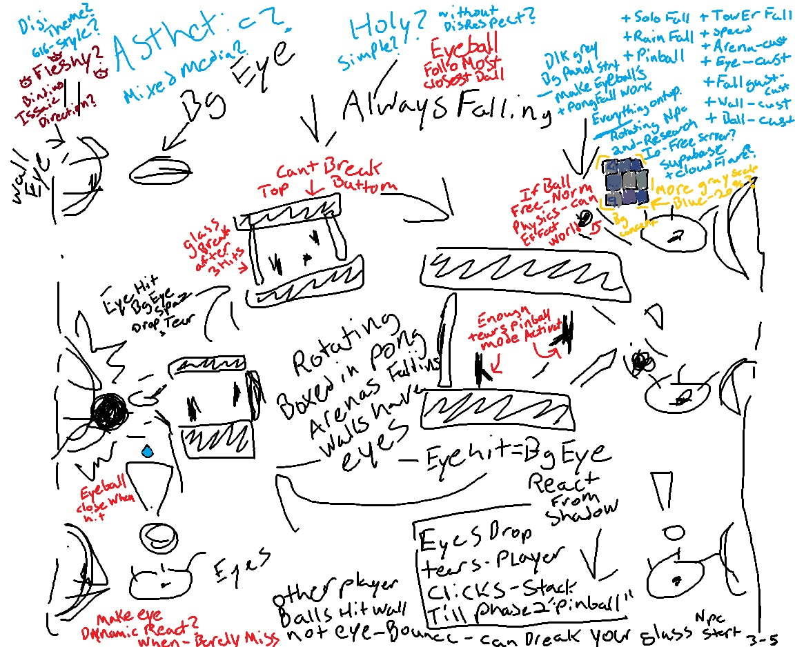

# Dev notes

## Jam entry: "The Walls Have Eyes!"

My entry for [Trijam 393](https://itch.io/jam/trijam-393), the three-hour game jam. It is my first proper jam, and I stayed under the three hours.

### The idea

When I read the theme, "The Walls Have Eyes", I sat there for a while. That is unusual for me: I usually have ideas fast, and executing them is the hard part. I wanted to take it down a religious route, but there was not much time. If I think the game is fun, I will spend more time on that after the jam, or if a creative idea comes to me.

What I landed on: a personal pong arena that falls and falls, like a game show, against an NPC or a friend. Each side has glass that breaks after 3 hits. Then it goes slow-mo, and the camera zooms out to show the crazy fall past strange walls. If a ball hits a wall, the eyes open. The back wall drops tears you can collect for an upgrade. The wall of eyes still lets the ball bounce back into your physics arena, which keeps rocking the arena and causing chaos. Both sides can score more because of it.

The feel I was after is the 2007 era of addictive browser games: stick games, Armor Games, you on WASD and your friend on the arrow keys, slow-mo Matrix games, Interactive Buddy. I thought of the energy of The Thing, and of falling past eyes that open and close, and getting hit in the eye with a ball. The pinball paddle came from a mix-up: I kept saying "pinball" when I meant "pong ball". My friend Jx pointed it out and suggested the pinball arm extension from my mistake.

When you win, the final point ("Dubs Through The Crack") screeches against the walls so large that you are no longer falling to your death. You are saved in... a game show? a creepy eyeball apocalypse? God watching? I have not decided yet.

### After the jam

- Carousel of other arenas playing alongside you with their own physics. Plan: the player with the best streak or biggest arena takes the front and centre, with a smooth transition in and out of the carousel. We will see if that is in my pay grade.
- Physics and creative sandboxes with a lot of customization are what my games are about, as I learn. In the last minutes before the deadline I added a hue shift lens with 8 filters I had in the back to slot in. It might not count for the jam, but I could not resist.
- I used a good amount of my outside and past tools, effects and shaders, plus my personal LOK ecosystem bundle for multiplayer.

### Credits and process

- The music is a Trijam mix that fit the vibe perfectly while I was building this. It is free for use the way I used it (I believe I followed the rules), and every credit goes to Trijam: https://www.youtube.com/@TrijamGJ
- This is documented because the work is a mix of my own design and coding with my personal LLM assistance. It is nothing like entries built entirely from scratch; there are very different levels of skill and work in a jam, so please check out the other entries: https://itch.io/jam/trijam-393
- Planning, logistics and deciding what to spend the time on were a big part of this one.

I hope you get a smile out of it.

(The original, unedited text is kept in `docs/jam-entry-original.md`.)

---

# Concept sketches

The designer's original paint sketches, kept as dev reference. The notes below transcribe each sketch and map it to what is built. The sketches are the source of intent; where this file and the code disagree, ask before "fixing" either.

## Sketch 2 (dated 3-5)

Sketch 1 (the original idea, drawn in a sketchpad) will be added when the designer can scan or photograph it. Until then this is the earliest record of the design.

### Transcription

**Aesthetic questions (top left, still open in the sketch)**
- "Aesthetic: mixed media?" / "Dis: theme?" / "616-style?"
- "Fleshy?" and "Binding of Isaac direction?" (the organic, eye-and-tear flavour)
- "Holy? Simple? Without disrespect?" (keep religious imagery out of it or handle it carefully)

**Core idea**
- "Always falling": the whole thing is a boxed-in pong arena that is constantly falling down a shaft.
- "Rotating boxed-in pong arenas falling. Walls have eyes."
- Wall eye: a plate-mounted eye in each side wall. "Eye hit = BG eye react from shadow": hitting a wall eye makes the dim background eyes react.
- "Eyeball follows closest ball."
- "Eye closes when hit." "Make eye dynamic: react when barely miss."

**Glass and goals**
- "Glass breaks after 3 hits."
- "Can't break top / bottom": the top and bottom walls are solid girders; only the two side glass panes break.

**Eyes, tears, pinball**
- "Eye hit, BG eye spazz, drop tear."
- "Eyes drop tears. Player clicks, stack, till phase 2 'pinball'."
- "Enough tears: pinball mode active": the flippers / pinball paddle comes in once enough tears are collected.

**Other players' balls and the NPC**
- "Other player balls hit wall not eye: bounce. Can break your glass."
- "NPC start" (the NPC arena starts the match).
- "If ball free: normal physics can affect work" (a loose ball obeys normal physics outside its arena).

**Background (top right panel)**
- "Dark gray BG panel strip: make eyeballs work + PongFall work."
- "Everything on top. Rotating NPC and research. Io-free server? Supabase + Cloudflare?" (hosting and backend notes)
- "More grayscale. Blue-ish." with a palette swatch of blue-grays, labelled "BG concept".

**Mode and customization wishlist (blue, top right)**
- Modes: Solo Fall, Rain Fall, Pinball, Tower Fall
- Options: Speed, Arena-custom, Eye-custom, Fall gust-custom, Wall-custom, Ball-custom

### Mapping to the build (as of 0.7.0)

| Sketch idea | State |
| --- | --- |
| Falling rotating arenas, walls with eyes | Built: deep shaft, carousel of other arenas, plate-mounted wall eyes |
| Glass breaks after 3 hits; top and bottom unbreakable | Built (girder ceiling and floor; per-side glass counters) |
| Eye hit makes background eyes react and drop a tear; tears stack toward pinball | Built: background eye reactions, tears, pinball paddle unlocked by tears |
| Other arenas' balls bounce off walls, can break your glass | Built on Sharp and Relentless (`hostile`) |
| Eyeball follows nearest ball | Partly: eye look is render-only; check it tracks the closest ball |
| Eye reacts when a ball barely misses | Open |
| Solo Fall | Built (mode) |
| Rain Fall, Tower Fall | Open (new modes, data in `src/sim/data/modes.ts`) |
| Pinball as a mode | Open (it is currently an in-match upgrade) |
| Customization: speed, arena, eye, gust, wall, ball | Open (partly covered by modifiers and tuning knobs) |
| Blue-gray background concept | Open: palette swatch in the sketch is the reference |
| Binding-of-Isaac / fleshy / mixed-media direction | Open art direction question |
| Io-free server, Supabase + Cloudflare | Open: milestone 4, owner applies the SQL |

Remember the repo rules when acting on any of this: game rules are data, the sim stays deterministic, and anything that changes how a recorded run plays out bumps `SIM_VERSION`.
